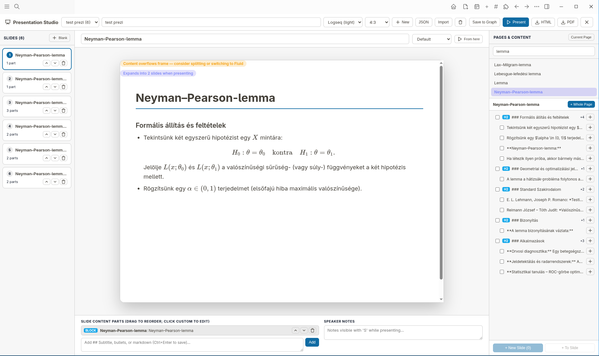

# Logseq Presentation Plugin

<p align="center">
  
</p>

Convert any Logseq page into a native fullscreen slide presentation, compose multi-page decks in **Presentation Studio**, save decks back into your Logseq graph with `[[Page]]` links, and export to standalone HTML or PDF.



## Features

- **One-Click Page Presentation**: Click the presentation icon next to any page title, use the toolbar button, run `/Present Page`, or press `Mod+Shift+P` to convert the current page and launch directly into native OS fullscreen **Presentation Mode**.
- **Smart Slide Splitting**:
  - `# H1` headings, `#slide`, or `slide:: true` start a new slide.
  - `##`–`######` headings render as clean subtitles (not bullets).
  - `---` or `***` blocks force a slide break (works on top-level and nested blocks).
  - **Auto-Split Long Slides**: Overflowing slides automatically break into continuation slides (`Title`, `Title (2/N)`, ...). Add `slide-no-split:: true` to opt out on a specific slide.
- **Rich Logseq Content**:
  - Markdown tables, blockquotes, highlights (`==text==`, `^^text^^`), task markers (`TODO`, `DOING`, `DONE`, etc.), tags, and clickable `[[Page]]` links.
  - Images (including local `../assets/` paths and `{:height N, :width N}` sizing) and video/YouTube embeds (`{{video url}}`, `{{youtube url}}`).
  - Live block and page embeds (`{{embed ((uuid))}}`, `{{embed [[Page]]}}`, `((uuid))`).
  - Offline syntax-highlighted code blocks (`highlight.js`), KaTeX math (`$...$`, `$$...$$`), and Mermaid diagrams (auto-matched to light/dark themes).
- **Presentation Studio**:
  - Open from **Presentations** in the left sidebar, the toolbar button, `/Presentation Studio`, or Command Palette.
  - Assemble slides from whole Logseq pages, individual blocks (with checkbox multi-select), and editable multiline custom markdown.
  - Drag-and-drop reorder slides and content parts, set per-slide layouts (`Default`, `Cover`, `2 Columns`), preview 1:1 WYSIWYG typography with overflow warnings, and edit speaker notes live.
- **Save & Load in Your Logseq Graph**:
  - Click **Save to Graph** to write your deck to `Presentations/<Deck Title>` with `type:: presentation`, theme/ratio metadata, live `{{embed ...}}` blocks, and `sources:: [[Page A]], [[Page B]]` links so every source page links back in Graph View.
  - Saved `Presentations/*` pages automatically appear under **Saved in Graph** in the deck picker so you can reload them into Studio anytime.
  - Also supports `.deck.json` backup export and import.
- **Themes & Aspect Ratios**:
  - **7 Themes**: `Logseq` (syncs live with your active Logseq theme CSS variables), `Light`, `Dark`, `Minimal`, `Midnight`, `Academic`, and `Warm Paper`.
  - **3 Aspect Ratios**: `16:9` (default), `4:3`, and `Fluid`.
- **Standalone Export**:
  - **HTML**: Self-contained interactive deck with keyboard navigation, progress bar, theme styling, and pre-rendered Mermaid SVGs.
  - **PDF**: Landscape print-optimized export with preserved theme colors and clean page breaks.

## Writing Slides in Logseq

Any normal Logseq page works out of the box. Use headings and block properties to control structure:

```markdown
- # Q4 Product Review
  slide-layout:: cover
  - Roadmap, metrics, and next milestones
- # Key Highlights
  slide-layout:: two-column
  slide-notes:: Mention customer retention jump in Q4.
  - ## Wins
    - Shipped v1.0 ahead of schedule
    - Reduced load time by 40%
  - 
  - Notes: Keep this section under 2 minutes
- ---
- # Architecture
  - ```mermaid
    flowchart LR
      Logseq --> Studio --> Player
    ```
```

### Supported Block Properties

| Property | Values | Effect |
| --- | --- | --- |
| `slide::` | `true` | Forces a block to start a new slide (same as `#slide` tag) |
| `slide-layout::` | `default`, `cover`, `two-column` | Sets slide layout (`cover` hides slide footer) |
| `slide-notes::` | any text | Adds speaker notes (also supports `Notes:` / `#notes` child blocks) |
| `slide-no-split::` | `true` | Disables automatic splitting for long slides |

## Controls & Shortcuts

### Logseq Commands

| Action | Trigger |
| --- | --- |
| Present Current Page | Page title icon, toolbar icon, `/Present Page`, or `Mod+Shift+P` |
| Open Presentation Studio | Left sidebar **Presentations**, toolbar icon, `/Presentation Studio`, or Command Palette |

### Presenter Mode Shortcuts

| Key / Action | Effect |
| --- | --- |
| `→`, `Space`, `PageDown`, click right 75% | Next slide |
| `←`, `PageUp`, click left 25% | Previous slide |
| `Home` / `End` | Jump to first / last slide |
| `P` | Toggle Presentation Mode (native fullscreen + auto-hiding controls) |
| `F` | Toggle fullscreen |
| `G` | Open slide overview grid |
| `S` | Toggle speaker notes drawer |
| `B` | Toggle screen blackout |
| `Esc` | Exit blackout / grid / close presentation |

## Installation

1. **Marketplace**: In Logseq, open **Plugins → Marketplace**, search for **Presentation**, and click **Install**.
2. **GitHub Release**: Download `logseq-presentation.zip` from [GitHub Releases](https://github.com/bdbotond/logseq_presentation/releases), unzip it, enable **Developer mode** in Logseq **Settings → Advanced**, then click **Plugins → Load unpacked plugin** and select the extracted folder.

## Development

Requirements: Node.js `>= 20`.

```bash
npm install
npm run typecheck
npm test
npm run build
```

Load locally in Logseq via **Plugins → Load unpacked plugin** and select the project root directory.

## License

MIT — see [LICENSE](LICENSE).
